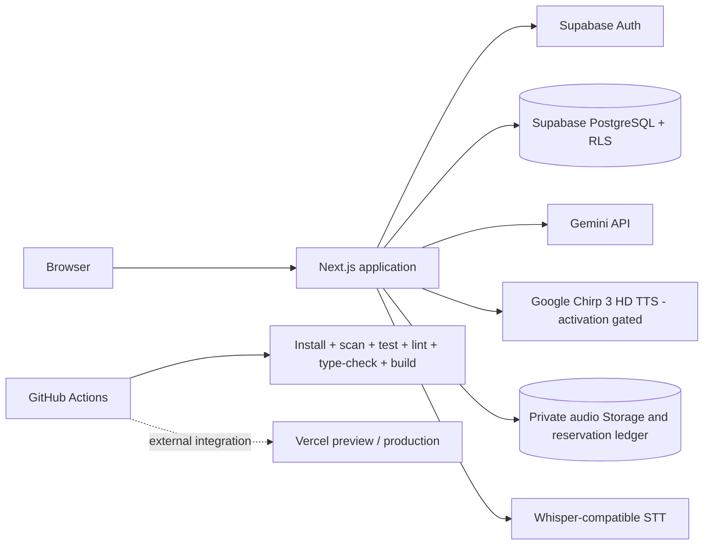

# LingoCoon System Overview

## Status

Current repository architecture snapshot; target learning architecture remains in `learning-engine.md`.

- Version: 1.2
- Last reviewed: 2026-09-15 (staged Google Reading TTS delta)

## Verified stack

| Layer | Repository evidence |
| --- | --- |
| Web | Next.js 16.3.3 App Router, React 19.2.3, Server Components, Server Actions, Route Handlers, and Proxy |
| Language and validation | TypeScript 5.9 in strict mode and Zod 4 |
| UI | Tailwind CSS 4, Radix UI, shadcn-compatible primitives, Framer Motion, Lucide, and Sonner |
| Data and identity | Supabase SSR/JS, Supabase Auth, PostgreSQL, RLS, and manually maintained local database types |
| Learning utilities | `ts-fsrs`, i18next, deck study, AI-assisted study, LexiCoon, TTS, and STT |
| Providers | Gemini text/structured generation, Google Chirp 3 HD for all TTS behind shared durable quotas, and configurable Whisper-compatible STT |
| Delivery | npm lockfile, GitHub Actions, and an external Vercel Git integration |

Versions come from the installed lockfile snapshot and must be rechecked after dependency changes.

## Current runtime

The browser receives Supabase public configuration and authenticated cookies. Server code resolves identity, owns provider credentials and system instructions, validates requests, and relies on PostgreSQL RLS for row ownership. External provider and deployment configuration is not established by this diagram.

## Application surfaces

- Public and identity: landing, login/signup actions, OAuth/OTP callback, confirmation, privacy, onboarding.
- Authenticated product: dashboard, decks/cards, classic and AI study, LexiCoon, settings.
- Server entry points: login and product Server Actions; STT and TTS Route Handlers; auth callback handlers; Proxy session refresh and route gating.
- Data: `profiles`, `decks`, `cards`, and `study_progress` in the current baseline.
- Reading source adds `/api/tts`, `/api/tts/cleanup`, a private Storage adapter and a forward migration for five cache/budget/rate/outbox tables. The migration is not applied; [Reading delivery](../product/context-studio.md) records controls and release gates.
- Google uses explicitly reconciled billing periods and a shared-budget RPC for both speech endpoints. No period is automatically created or renewed. Plain-text Chirp chunks produce validated WAV-to-PCM audio without word timestamps. The Chirp migration disables prior allowances and caps new periods at 999,700 characters. SQL execution and hosted acceptance remain pending; see the current Context Studio delivery record.
- Target-only data: mission sessions, normalized learning events, error signals, recommendations, and general AI/STT usage reservations. Reading-specific reservation SQL now exists but has no verified deployment.

## Current versus target

| Concern | Current implementation | Approved target |
| --- | --- | --- |
| Primary loop | Decks, flashcards, dictionary, AI chat/study | Mission-based four-skill personalized learning |
| Personalization | Onboarding profile and limited prompt context | Evidence-based learner profile, signals, and explainable recommendations |
| Speaking | STT input and text-level AI interaction | Bounded speaking mission with transcript review, retry, confidence, privacy, and fallback |
| Usage control | Input limits; process-local STT burst limiter | Atomic persistent per-user and global reservations for AI/TTS/STT |
| Tests | Security boundary/storage tests and standalone database security SQL | Unit, integration, API, component, RLS, E2E, accessibility, and performance coverage |
| Database typing | Handwritten types that do not fully represent the baseline | Repeatable schema-generated types reconciled with every migration |

## Security and ownership boundaries

- Client route gating improves UX but is not authorization; Server Actions, Route Handlers, and RLS must enforce identity and ownership.
- `NEXT_PUBLIC_*` values are browser-readable. Provider secrets must remain server-only.
- Learner, deck, card, transcript, and model text are untrusted data and never become system instructions.
- AI does not own authorization, persistence rules, scoring truth, usage budgets, or recommendation state.
- Supabase service-role access is now required only by the gated Reading server cache/cleanup adapter. Never introduce it client-side; verified session ownership is resolved before this privileged boundary.
- GitHub, Vercel, Supabase, OAuth, and provider dashboards are external systems; repository access does not authorize their mutation.

## Deployment and observability limits

The repository verifies its build and CI source, not the live deployment. It does not currently version Vercel project settings, preview/production environment assignment, provider retention settings, field observability, automated rollback, or Core Web Vitals. Those require authorized external inspection and should remain explicit unknowns.

## Related contracts

- Target learning flow: `learning-engine.md`
- Target data model: `data-model.md`
- AI boundaries: `ai-contracts.md`
- Environments: `../engineering/environments.md`
- Security baseline and threat model: `../security/`
