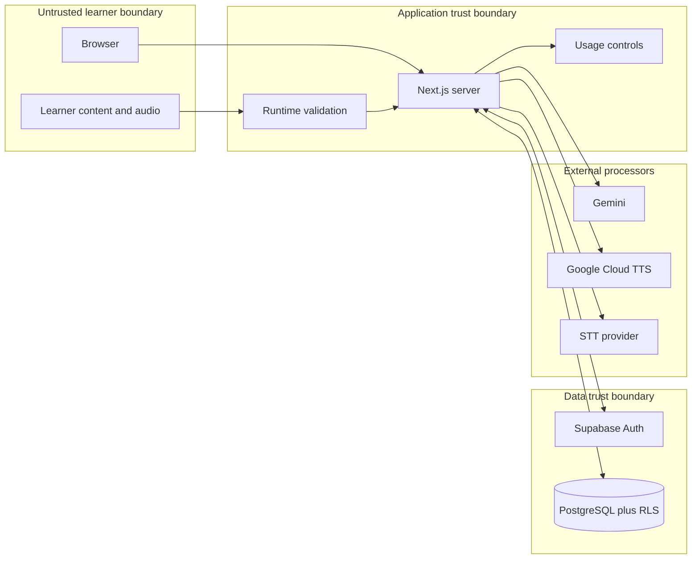

# LingoCoon Threat Model

## Status

Source-backed model of the current repository and the approved first-mission direction. It is not proof of live production configuration or a penetration-test result.

- Version: 1.2
- Last reviewed: 2026-09-15 (bounded staged Google delta; prior sections retain their original review scope)
- Review method: repository inspection plus two independent read-only audit passes; final documentation reconciliation was sequential because an additional reviewer was unavailable

## Scope and security objectives

This model covers the browser, Next.js application, Supabase Auth/PostgreSQL, AI/TTS/STT providers, GitHub CI, and the external Vercel deployment integration represented in source. It excludes uninspected provider dashboards, live Supabase state, Vercel settings, DNS, user devices, and future multiplayer.

The system must preserve:

- account and session integrity;
- owner-only access to profile, deck, card, progress, and future learning data;
- confidentiality of credentials, learner content, transcripts, and operational metadata;
- integrity of learning evidence, recommendations, scores, and usage accounting;
- availability within a zero-budget provider envelope;
- learner control over personalization, retention, export, and deletion.

## Components and evidence

| Component | Trust role | Repository evidence |
| --- | --- | --- |
| Browser | Untrusted presentation and input boundary | `src/proxy.ts:6-58`; public configuration described in `docs/engineering/environments.md` |
| Next.js server | Authenticates, validates, authorizes, calls providers, and returns bounded responses | `src/lib/supabase/auth.ts:10-36`; `src/lib/actions/ai-actions.ts:46-62`; TTS/STT Route Handlers |
| Supabase Auth | Identity and session issuer | Server clients and callback flow; live Auth/OAuth configuration is external |
| PostgreSQL/RLS | Persistent owner boundary and integrity layer | `supabase/baseline/20260901_public_schema.sql:259-306`; hardening migrations and database tests |
| Gemini | External processor for text and structured generation | `src/lib/server/ai-client.ts:116-181` |
| Google Cloud TTS | External speech processor behind shared reservations | `src/lib/server/reading-tts/runtime.ts`, `google.ts`, `compatibility.ts` |
| STT provider | External audio/transcript processor | `src/app/api/stt/transcribe/route.ts:21-80` |
| GitHub Actions | Untrusted-change verification boundary | `.github/workflows/ci.yml:11-56` |
| Vercel | External build/runtime boundary | Git integration is observed; settings and environment assignment are unverified |

## Trust boundaries and data flow

The browser and every user-supplied identifier are untrusted. Proxy route gating is UX protection, not authorization: API paths bypass it (`src/proxy.ts:21-23`), so each Server Action/Route Handler and RLS policy must independently enforce identity and ownership. Provider responses and errors are also untrusted.

## Assets and attacker profiles

Primary assets are provider credentials, sessions, personal profile data, learner-created content, audio/transcripts, progress and future learning signals, provider budget, service availability, source and deployment integrity, and audit evidence.

Relevant attackers include an anonymous internet user, an authenticated abusive learner, one learner targeting another learner's objects, a malicious prompt/content author, a compromised dependency or pull request, and an operator making an unsafe configuration or migration change. A provider or platform compromise is treated as a supply-chain/external dependency risk, not something application code can eliminate.

## Verified controls

- Server-side identity helpers reject missing claims (`src/lib/supabase/auth.ts:17-36`).
- The OAuth callback converts `next` into an internal path and rejects foreign origins (`src/app/auth/callback/route.ts:8-19`).
- Site-origin selection accepts only HTTP(S) origins and avoids a local URL on Vercel (`src/lib/server/site-url.ts:10-47`).
- Tutor input is parsed into server-owned instructions and bounded untrusted history before Gemini (`src/lib/actions/ai-actions.ts:46-58`).
- STT authenticates, validates media type/size/language, and uses a timeout (`src/app/api/stt/transcribe/route.ts:21-53`).
- TTS authenticates, validates body/text/voice/speed, and uses a timeout (`src/app/api/tts/synthesize/route.ts:69-119`).
- Current tables have owner-oriented RLS; hardening removes anonymous table access, narrows function execution, uses invoker mode where appropriate, and enables RLS automatically for future public tables (`supabase/migrations/20260901010000_harden_public_access.sql:40-64`).
- CI has read-only repository permission, immutable action pins, current-tree secret scanning, security tests, lint, type-check, and build (`.github/workflows/ci.yml:11-56`).
- Security headers deny framing, object embedding, MIME sniffing, and unnecessary browser capabilities (`next.config.ts:4-29`).

## Prioritized threat hypotheses

| Priority | Threat path | Evidence and current control | Impact / confidence | Required treatment |
| --- | --- | --- | --- | --- |
| P1 | An authenticated user repeatedly invokes AI, TTS, or STT until a shared provider quota or budget is exhausted | TTS has no limiter; STT uses a process-local `Map` (`src/app/api/stt/transcribe/route.ts:9-12,84-95`); no atomic usage reservation is implemented | Medium availability/cost risk; high confidence | Add persistent per-user and global reservations, concurrency limits, retry accounting, hard stops, and deterministic fallback tests |
| P1 | A learner creates or updates `study_progress` for a card UUID owned by another learner | FK accepts any existing card ID (`supabase/baseline/20260901_public_schema.sql:65-84`); progress policies check only `user_id` (`:299-306`) | Low current integrity/privacy impact; high-confidence policy gap, exploitation also requires a foreign UUID | Require the referenced card's deck owner to equal `auth.uid()` in INSERT/UPDATE policy checks; add owner/other-user SQL tests |
| P1 | Sensitive learner/provider data reaches logs or a provider unnecessarily | Provider error bodies are logged (`src/lib/server/ai-client.ts:161-169`; TTS `:121-145`; STT `:55-80`); stable Supabase subject is sent as Gemini `user` (`src/lib/server/ai-client.ts:125-134`) | Medium privacy/incident-response risk; high confidence | Centralize redacted structured errors, prohibit content/error-body logging, pseudonymize or omit external user IDs, define retention and tests |
| P2 | Preview or pull-request code obtains production data or credentials | CI itself is read-only and declares no provider secrets, but Vercel/Supabase/OAuth environment assignments are external | Potential high impact; state unknown | Inspect dashboard metadata without values, separate preview/production resources, restrict PR deployment authority, and record readback |
| P2 | OAuth consent grants more durable access than the application needs | Google login requests `access_type=offline` and repeated consent (`src/app/login/actions.ts:56-71`); no repository consumer of a Google refresh token was found | Low-to-medium account/privacy exposure; high confidence on unnecessary source request | Remove offline access/forced consent unless a documented feature requires it; regression-test login and callback behavior |
| P2 | Prompt injection changes authorization, leaks a server secret, or writes arbitrary learner state | System instructions and history are separated; model has no database/tool authority in the reviewed path; secrets stay in server configuration | High theoretical impact but low current exploitability in reviewed tutor path | Preserve typed operations, no provider tools, output validation, no secret-bearing context, adversarial tests, and operation-specific review |
| P2 | Live database state drifts from versioned policies or a migration partially applies | Baseline, forward migrations, and transactional SQL checks exist; database test is not part of CI and live state was not re-read in this review | Medium authorization risk; medium confidence | Add an isolated Supabase test pipeline, migration ledger/readback, and periodic approved metadata-only drift check |
| P3 | Script/style injection or content exfiltration uses a missing CSP directive | Current CSP sets only `base-uri`, `form-action`, `frame-ancestors`, and `object-src` (`next.config.ts:4-8`) | Low incremental protection gap; framework escaping remains primary control | Design and deploy a complete nonce/hash-compatible CSP only after inventorying Next.js/provider connections and preview behavior |
| P3 | A credential-shaped value evades the repository scanner | Scanner plus self-tests cover known patterns and reachable history, but pattern matching is not universal proof | Variable impact; known residual limitation | Keep server-side secret management, provider leak detection, review, rotation procedure, and GitHub scanning where available |

## Rejected or constrained attack stories

- Arbitrary callback redirect: constrained by internal-origin normalization; retain tests for encoded, protocol-relative, nested, and malformed values.
- Anonymous database reads through the Supabase anon key: current source grants and RLS fail closed, but only an isolated role matrix or approved live readback proves the deployed state.
- Prompt injection reading `.env.local`: the reviewed tutor path has no filesystem/tool access and does not place environment values in model context. This does not justify sending secrets to prompts or exposing future tools.
- Service-role key in the browser: no current runtime use was found; introducing it client-side is prohibited.

## Reading TTS boundary delta — 2026-09-14

Historical provider evidence below is superseded by the current Chirp delta.

Source changes add a new external processor and privileged cache path, not a
verified production deployment. Exact contracts/limits live in
[Reading delivery](../product/context-studio.md#online-tts-contract--2026-09-14).
This bounded append is based on reviewed source and protocol/controller tests;
the older independent audit passes did not review this addition.

| Boundary / attacker story | Source-backed containment | Residual question / impact |
| --- | --- | --- |
| Authenticated abuse triggers paid or concurrent synthesis, including after promo expiry | `src/app/api/tts/route.ts`, `src/lib/server/reading-tts/handler.ts`, `service.ts`, and `supabase/migrations/20260913010000_reading_tts.sql`: verified owner, bounded Zod, same-origin, rate windows, atomic lifetime/day/user reservations, credit-expiry headroom, leases and conservative failure charges | Potential cost/availability impact. SQL/billing are not live-verified; external use of the same account can invalidate headroom. Positive allowance requires owner approval; zero remains default. |
| Another learner guesses a cache key or asks for a signed private object | `cache-key.ts` binds owner/text/voice/model with HMAC; `store.ts` verifies owner/key paths; migration denies anon/authenticated table and private-bucket access, including restrictive Storage WITH CHECK | Potential private-content disclosure if service-role ownership checks or deployed ACLs drift. Keys/Storage URLs stay server-side. Cross-owner dedup is deliberately not implemented. Require isolated and HTTP role tests. |
| Provider sends malformed/oversized PCM, mismatched tokens or ambiguous timestamps | `inworld.ts` and `src/lib/reading-tts/contract.ts`: fixed HTTPS destination, bounded NDJSON/schema/audio, exact original-text mapping, no estimated timings. `audio-session.ts` rejects invalid order/offsets/duration | Availability/learning-correctness risk, not proof of code execution. Live multi-chunk timestamps/voice quality and Safari/iOS remain unverified. |
| Worker crashes or account deletion loses audio cleanup/accounting | Private outbox trigger survives owner cascade, reserves in-flight bytes/concurrency through lease expiry; `store.ts` removes exact objects before fenced metadata deletion; authenticated `/api/tts/cleanup` uses a total deadline and reports backlog | Potential retention/storage availability impact. A deployed working cron and physical deletion proof are mandatory; failed deletion can exceed nominal TTL. Account-deletion UX/export remains a separate gap. |

Only synthesis text/language/voice/model/audio parameters are sent to Inworld;
no profile/email/subject metadata is added. Learner text itself may still contain
personal data. Server logs are content-free status/latency/byte counts. Processor
retention, commercial terms, international transfers, free-tier hosting/egress,
credential scoping and full privacy notice require external review/readback.
There is no local model or personal-Mac runtime fallback.

## Staged Google TTS delta — 2026-09-15 (superseded)

`src/lib/server/reading-tts/google.ts` adds a fixed Google HTTPS destination,
server-only API-key header, bounded JSON/WAV parsing and no upstream retries.
`google-plan.ts` XML-escapes learner content so it cannot add voice/audio/URL
SSML directives. Only catalog WaveNet IDs are selectable. No learner identifiers
are sent to Google. Missing temporal marks never cause estimated word clipping.

`supabase/migrations/20260914010000_google_tts_budget.sql` adds a service-only
shared-period reservation wrapper and RLS/no-client-grant period ledger. It uses
the original singleton lock, reserves conservatively computed billed units,
includes reconciled outside usage, forbids overlapping periods and fails closed
without a reviewed active period. Existing quotas/cache ownership/concurrency
and cleanup fencing remain. Cache hits do not consume generation allowance.

Residual risks: SQL/RLS/concurrency have not been executed in an isolated DB;
300-character nominal headroom cannot absorb unrecorded external usage; billing
boundaries and current account usage are unverified; default legacy daily/storage
caps still restrict capacity. Google credentials could be used outside the app,
so application limits are not a provider-side hard spending guarantee. Runtime
activation is disabled. Real mark reliability, private-content processor review,
retention, hosted egress and browser performance remain release gates. The
independent reviewer was unavailable; this is parent source review plus mocked
tests, not an independent security audit. See [current delivery](../product/context-studio.md).

## Current Chirp-only delta — 2026-09-15

Both speech routes now use `runtime.ts` and the same authenticated durable
reservation path. `compatibility.ts` bounds and validates the complete WAV
response for HTMLAudio consumers. `google.ts` uses a fixed Google destination,
server-only key, bounded WAV decoding and no retries. `google-plan.ts` sends
plain text, never user-controlled SSML or URLs, and restricts voices to Chirp
Achernar/Charon. No profile identifier is sent to Google; learner text may
contain personal information. The local direct bypass and legacy providers
were removed.

The Chirp migration disables old periods, preserves counters and caps periods
at 999,700. A non-Chirp period cannot authorize dispatch. Authenticated abusive
users remain subject to shared daily/user/concurrency/storage and monthly gates;
external key use can still exceed app accounting. A leaked server-role key
remains privileged, so server-only scoping and deployed ACL verification matter.
This bounded source update is not a new independent security audit.

SQL/RLS concurrency, provider retention, physical cleanup, hosted costs and
post-change authenticated audio are still release gates. Missing durable
configuration now blocks local audio too. No guessed word timestamps or paid
fallback mask failures. See [current delivery](../product/context-studio.md).

## Change triggers

Update this model before merging a change that adds a provider, file upload, service-role operation, privileged database function, new user-owned table, background job, analytics pipeline, cross-user sharing, moderation, multiplayer, raw-audio retention, new deployment environment, or model tool access. Recalibrate threats after incidents, provider-term changes, or material architecture changes.

## Verification and residual uncertainty

Repository checks can validate source, tests, migrations, dependencies, and reachable Git content. They cannot prove live OAuth scopes, Vercel secret assignment, provider retention, Supabase drift, DNS, or successful credential rotation. Those require explicit external authorization, metadata-only inspection where possible, and recorded readback.

Related contracts: [security baseline](security-baseline.md), [environments](../engineering/environments.md), [privacy](../governance/privacy.md), [test strategy](../engineering/test-strategy.md), and [AI contracts](../architecture/ai-contracts.md).
